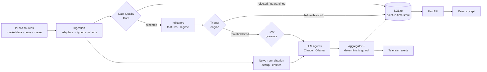

# Argus

[](https://github.com/LightWonkas/argus/actions/workflows/ci.yml)
[](LICENSE)


**Always-on market and news monitoring with LLM-assisted decision support.** Argus ingests public
market data and news, gates it on data quality, computes indicators locally, and only wakes a
language model when a threshold fires. Results land in a point-in-time store, a React cockpit and
Telegram alerts.

> **For research and educational purposes only. Not financial advice.**
> Argus places no orders and holds no exchange credentials.

<!-- Screenshot placeholder: add docs/assets/cockpit.png and uncomment.

-->

## Features

- **Source adapters behind one contract.** Binance public REST and WebSocket, publisher RSS/Atom
  feeds, CryptoPanic, Finnhub, TCMB EVDS macro series, and optional OpenBB and BIST/KAP
  integrations.
- **Data Quality Gate.** Stale, gapped, duplicated, out-of-order or outlier series are flagged,
  quarantined or rejected before anything downstream sees them.
- **Local indicators and triggers.** RSI, EMA, MACD, ATR and more are computed without a model, so
  routine monitoring costs nothing.
- **Threshold-triggered LLM analysis.** A cost governor with a daily budget decides whether a model
  is called. Anthropic Claude, local Ollama, or an offline demo client; roles map to models
  independently.
- **Evidence-tiered output.** Every analysis carries an evidence tier, a confidence value and the
  condition that would invalidate it. Missing data is reported as missing.
- **News pipeline.** Deduplication, entity resolution, source health and point-in-time timestamps;
  untrusted content is treated as data, never as instructions.
- **Deterministic risk guard and backtesting.** Model output never overrides the guard. Backtests
  include costs and baselines.
- **Simulation only.** A "shadow" engine and a mission state machine evaluate research plans on
  paper. There is no live execution path (see [Simulation boundary](#simulation-boundary)).
- **Cockpit.** FastAPI backend and a React dashboard with a draggable widget grid, health view,
  hit-rate tracking, a settings page and a copilot chat.
- **Alerts.** Telegram notifications with prioritisation, quiet hours, cooldown and a daily briefing.

## Architecture



The design decisions behind this (why the model is only called on triggers, why quality gates block
instead of warn, how point-in-time correctness is kept) are in
[docs/ARCHITECTURE.md](docs/ARCHITECTURE.md).

## Tech stack

| Area | Technology |
| --- | --- |
| Backend | Python 3.11+, pydantic, structlog, SQLite (WAL) |
| API | FastAPI, uvicorn |
| LLM | Anthropic SDK, Ollama (local), provider-neutral client protocol |
| Data | ccxt, websockets, RSS/Atom, optional OpenBB and borsapy |
| Scheduling and messaging | APScheduler, Redis (optional event bus), Telegram Bot API |
| Web | React 18, TypeScript, Vite, Tailwind CSS, lightweight-charts, Vitest |
| Tooling | ruff, mypy (strict), pytest, ESLint, Docker Compose, GitHub Actions, gitleaks |

## Quickstart

### Docker

```bash
git clone https://github.com/LightWonkas/argus.git
cd argus
docker compose up --build
```

Open <http://localhost:3000>. The stack starts offline with no API keys: a one-shot `seed` service
writes **synthetic** candles (source `synthetic-demo`) so the watchlist, chart and indicator widgets
have something to draw. Those numbers are generated, not market data, and they are marked stale once
they age. Widgets that depend on live processes (crypto monitor, news, alerts) show `DATA PENDING`
until the watch profile is running.

In Docker, keep secrets in `.env` on the host. Watchlist and threshold changes saved from the
settings page persist in the `app-config` volume.

To collect real public data and send alerts, create `.env` (see [Configuration](#configuration))
and add the watch profile:

```bash
cp .env.example .env
docker compose --profile watch up --build
```

### Local

Requires Python 3.11+ and Node.js 22.

```bash
python -m venv .venv
. .venv/bin/activate                 # Windows: .venv\Scripts\activate
pip install -e ".[dev,dashboard]"

python scripts/seed_demo.py          # synthetic demo data, no network
python -m argus --dashboard          # API on http://127.0.0.1:8787
```

In a second terminal:

```bash
cd web
npm ci
npm run dev                          # cockpit on http://localhost:3000
```

### Commands

| Command | What it does |
| --- | --- |
| `python -m argus` | Print the version and a health summary |
| `python -m argus --health` | Run the health checks only |
| `python -m argus --status` | Version, LLM budget and hit rate |
| `python -m argus --dashboard` | Serve the cockpit API |
| `python -m argus --watch` | Run the watch loop (needs the `ingestion` and `interface` extras) |
| `python -m argus --crypto-refresh` | One public REST universe, quality and feature cycle |
| `python -m argus --crypto-stream` | Record public spot and perpetual WebSocket streams |
| `python -m argus --news-refresh` | Fetch and store the configured RSS/Atom feeds once |
| `python -m argus --bot` | Telegram command bot (`/status`, `/analyze <SYMBOL>`) |
| `python -m argus --consumer` | Redis push consumer for instant news alerts |

Optional extras: `ingestion`, `platform`, `brain`, `interface`, `dashboard`, `openbb`, `bist`.
Install what you need, for example `pip install -e ".[ingestion,brain,interface]"`.

## Configuration

Secrets and infrastructure come from environment variables (`.env`, never committed). Everything
else is plain data in `config/config.yaml`; when that file is absent the shipped
[`config/config.example.yaml`](config/config.example.yaml) is used. Its thresholds are illustrative
defaults, not tuned recommendations.

| Variable | Default | Purpose |
| --- | --- | --- |
| `ARGUS_ENV` | `dev` | `dev` or `prod` |
| `ARGUS_LOG_LEVEL` / `ARGUS_LOG_FORMAT` | `INFO` / `console` | Logging; `json` for production |
| `ARGUS_DATABASE_URL` | `sqlite:///data/argus.db` | SQLite store location |
| `ARGUS_REDIS_URL` | `redis://localhost:6379/0` | Optional event bus |
| `ARGUS_LLM_PROVIDER` | `claude` | Global provider: `claude` or `ollama` |
| `ANTHROPIC_API_KEY` | empty | Required only for Claude |
| `ARGUS_OLLAMA_BASE_URL` / `ARGUS_OLLAMA_MODEL` | `http://localhost:11434` / `llama3.2` | Local LLM |
| `ARGUS_LLM_DAILY_BUDGET_USD` | `3.0` | Daily LLM spend ceiling |
| `ARGUS_PROVIDER_<ROLE>` / `ARGUS_MODEL_<ROLE>` | see `.env.example` | Per-role provider and model |
| `TELEGRAM_BOT_TOKEN` | empty | Telegram alerts and bot |
| `ARGUS_AUTHORIZED_CHAT_IDS` | empty | Comma-separated chat ids allowed to use the bot |
| `ARGUS_DASHBOARD_USERS` | empty | `name:hash` pairs. Empty disables auth, including on the settings endpoints that write `.env` and `config.yaml`: local use only |
| `ARGUS_DASHBOARD_SESSION_SECRET` | random per process | Session cookie signing key |
| `ARGUS_DASHBOARD_BIND` / `ARGUS_DASHBOARD_PORT` | `127.0.0.1` / `8787` | API listen address |
| `ARGUS_EVDS_KEY`, `ARGUS_FINNHUB_KEY`, `ARGUS_CRYPTOPANIC_TOKEN` | empty | Optional data providers |

The full list with comments is in [`.env.example`](.env.example). With no keys at all, Argus still
runs: indicators, triggers and guards are deterministic, and the demo LLM client says plainly that
no model is connected.

Generate a dashboard password hash with:

```bash
python -c "from argus.api.security import hash_password; print(hash_password('<password>'))"
```

## Project structure

```text
argus/
├── src/argus/
│   ├── core/            typed contracts, enums, errors, retry and circuit breaker
│   ├── config/          settings from env, YAML loader and models
│   ├── ingestion/       source adapters (market data, news, macro)
│   ├── platform/        quality gate, indicators, triggers, news normalisation, event bus
│   ├── brain/           LLM clients, router, cost governor, agents, prompt-injection handling
│   ├── decision/        aggregator, deterministic guard, backtests, research planner
│   ├── execution/       capability contracts and the simulated (shadow) engine
│   ├── interface/       watch loop, scheduler, Telegram, runtime orchestration
│   ├── api/             FastAPI dashboard API
│   ├── storage/         SQLite store, outcome evaluation
│   └── observability/   logging, health, readiness
├── web/                 React cockpit
├── scripts/             seed_demo, feed_once, backtest, golden_eval, soak and stress tools
├── config/              config.example.yaml
├── tests/               offline unit and integration tests
└── docs/                ARCHITECTURE.md
```

## Development

```bash
pip install -e ".[dev,ingestion,platform,brain,interface,dashboard]"
ruff check src tests scripts && ruff format --check src tests scripts
mypy
pytest
```

```bash
cd web && npm run lint && npm run build && npm test
```

Tests run offline; adapters take injected clients. See [CONTRIBUTING.md](CONTRIBUTING.md).

## Data sources and terms of use

The adapters in this repository call documented public APIs and publisher-provided RSS/Atom feeds;
they contain no HTML scraping code. Two things go beyond that and are opt-in:

- The `bist` extra installs `borsapy`, an unofficial third-party library for Turkish market data
  (BIST, KAP). How it obtains data is outside this project's control. It is not installed by the
  Docker image or by CI.
- With Claude as the provider, on-demand deep analysis (`/analyze`) uses Anthropic's server-side
  web search tool, which adds cost and brings in third-party web content. Scheduled routine analysis
  does not.

You are responsible for complying with the terms of every source you enable, including rate limits
and redistribution rules. No market or news data is shipped in this repository.

## Simulation boundary

The codebase contains a research surface that looks like trading infrastructure: a mission state
machine (arm, halt, kill switch), a planner, a portfolio allocator and a shadow engine with simulated
fills. It exists to study how a guarded pipeline would behave, and it is deliberately incomplete:

- There is no private exchange client, no request signing and no order endpoint.
- `live_execution_enabled` and `submission_authorized` are typed as always-false.
- `TESTNET` and `LIVE_SPOT` modes are declared in the contracts and rejected at runtime.
- Limits in the example config such as `daily_profit_stop_pct` are stop conditions for the
  simulation, not targets or expectations.

## Roadmap

- PostgreSQL/TimescaleDB storage backend next to SQLite
- More official news and macro sources behind the adapter contract
- Server-sent events for live cockpit updates
- OpenAI-compatible providers through the existing client protocol
- Retrieval over the decision journal

## Disclaimer

For research and educational purposes only. Not financial advice. Nothing produced by this software
is a recommendation to trade any asset. Simulated results do not predict real-world outcomes. You
use it at your own risk.

## License

[Apache License 2.0](LICENSE)
