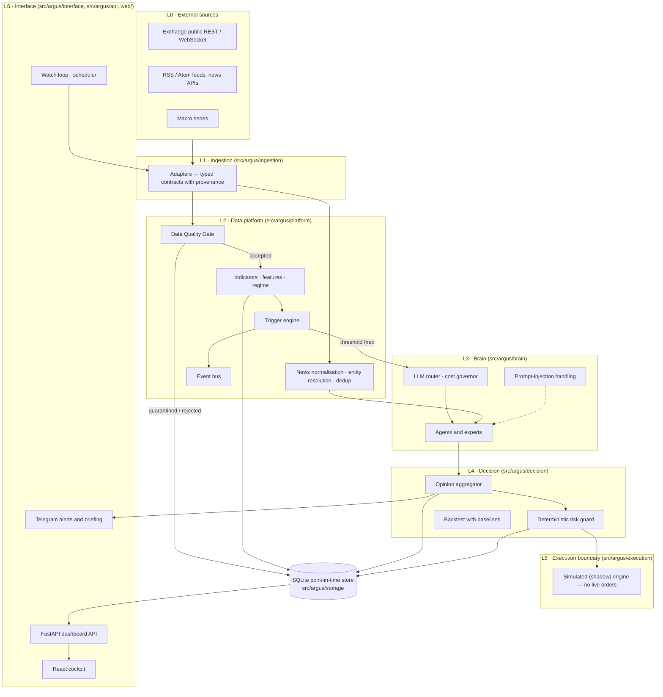
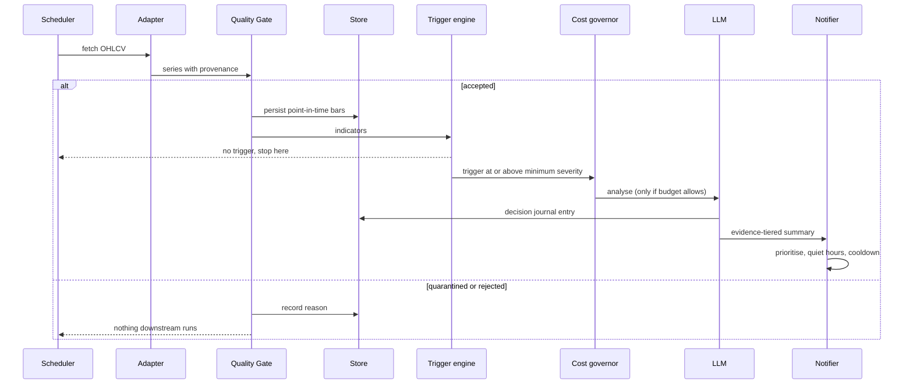

# Architecture

Argus watches markets and news around the clock and turns what it sees into evidence-labelled,
research-grade summaries. It is a decision-support system: it never places orders and it does not
give financial advice.

This document explains how the pieces fit together and why they are shaped the way they are.

## Layers

Argus is layered and event-driven. Every external source is converted into a shared, typed contract
at the edge, and layers only talk to each other through those contracts.



Cross-cutting packages:

| Package | Role |
| --- | --- |
| `core` | Typed contracts, enums, error hierarchy, retry and circuit breaker |
| `config` | Secrets and infrastructure from environment variables; editable data config from YAML |
| `storage` | SQLite store: time series, decision journal, outcomes, news, audit |
| `observability` | Structured logging, health registry, readiness evaluation |

## Data flow

### Watch loop

`python -m argus --watch` runs the scheduler, which drives the watch loop at different cadences for
holdings, the watchlist and the broad universe.



### News and events

```text
Source registry → RSS/Atom adapter → raw document
  → entity resolution + deduplication → normalised event
  → point-in-time market reaction → research result → plan (research only) → guard
```

Sources are typed records in `config/config.yaml`. A source without a verified machine-readable feed
stays `manual_configuration_required` rather than getting an invented URL. The adapters
in this repository read publisher-provided feeds and documented APIs; they do not scrape HTML. The
optional `bist` extra delegates to a third-party library whose data access is outside this project's
control.

### Cockpit

`python -m argus --dashboard` serves a FastAPI app. Its data views only read what the other
processes wrote to the store: the cockpit never triggers market-data collection and never recomputes
an analysis to fill a widget. Missing values are shown as missing.

The API is not read-only as a whole. The settings page writes `config.yaml` and `.env`, the copilot
chat and the manual news-routing endpoint call the configured LLM, feedback is stored, and the
simulation surface has mission control endpoints. None of them can place an order.

## Design decisions

### The LLM is called only when a trigger fires

Indicators and thresholds are computed locally and cost nothing. A language model is only invoked
when a trigger reaches the configured severity and the daily budget allows it. This keeps cost
bounded and predictable, keeps the system useful when no model is reachable, and means the model is
always asked a specific question about specific evidence.

A cost governor tracks spend per day and per role. Roles (`routine`, `deep`, `copilot`,
`news_router`, `exchange_expert`) are bound to a provider and model independently, so cheap or local
models can handle routine work.

### Data quality gates block, they do not warn

Every series passes the Data Quality Gate before anything else sees it. The gate checks for empty
series, staleness, duplicates, gaps, out-of-order bars, outliers, future timestamps and
insufficient history, and maps each finding to an action: accept, accept with warning, quarantine or
reject. A quarantined or rejected series produces no features, no agent opinions and no candidates.

The reasoning is simple: a confident summary built on stale or broken data is worse than no summary.

### Honesty over completeness

If a value is not available, the system says so. The constant `DATA PENDING` and explicit states
such as `no_data`, `stale`, `degraded` and `unavailable` are used instead of zeros, defaults or
placeholders. Each record carries provenance (source, fetch time) and each analysis carries an
evidence tier:

| Tier | Meaning |
| --- | --- |
| A | Computed from data |
| B | Observed on the chart or in a source |
| C | Framework interpretation |

When tiers disagree, A outranks B outranks C. Every analysis also states its confidence and the
condition that would invalidate it.

### Point-in-time everywhere

Stored prices are raw; adjustments are applied at read time. News keeps three separate timestamps:
when the publisher says it was published, when Argus first saw it, and when it was ingested. Replay
and backtest queries filter on `first_seen_at <= as_of`, so the system never learns from information
it did not have at the time. Feature and planning code uses closed candles only.

### The model explains, deterministic code decides

Language models synthesise evidence. They do not produce prices, quantities or permissions. Risk
checks live in a deterministic guard that does not trust model output and cannot be skipped. Missing
portfolio or risk inputs produce a safe rejection. The default decision is `no_trade`.

### Untrusted content is data, not instructions

News, web content and disclosures are passed to models as quoted data with explicit instructions to
ignore embedded directives. The output schema is fixed and parsed strictly, with conservative
fallbacks when a field is missing or malformed.

### No live execution

There is no private exchange client, no signing code and no order endpoint in this codebase. The
execution package defines typed capability boundaries and a simulated ("shadow") engine for research.
The contracts name `TESTNET` and `LIVE_SPOT` modes so the boundary is explicit, and the runtime
rejects them. Order intents are pinned to `submission_authorized = false`. Simulation results are not a promise of
real-world performance.

### Adapters behind dependency injection

Heavy and optional third-party libraries are imported lazily inside the adapter that needs them,
and network clients are injected. Unit tests use fake providers and never touch the network. Adding
a source means implementing the adapter contract in `src/argus/ingestion/base.py` and registering it.

### Provider-neutral LLM seam

`src/argus/brain/llm.py` defines one small client protocol. Anthropic Claude, a local Ollama server
and an offline demo client implement it. With no API key configured, Argus still runs: deterministic
indicators, triggers and guards keep working, and the demo client answers honestly that no model is
connected.

### One process per concern, one SQLite file

The dashboard, the watch loop and the WebSocket stream are separate processes that share a SQLite
database in WAL mode. Stream data is rolled up into one-minute summaries instead of storing raw
trades and depth deltas, and a retention job trims expired raw rows in bounded batches only after
the roll-up succeeded.

## Resilience

- Retries with backoff and a circuit breaker around external calls (`core/resilience.py`).
- Degraded mode: if a source goes down, the rest keeps running and the outage is surfaced.
- Cooldowns are persisted, so a restart does not replay the same alert.
- The health endpoint reports each component separately and does not present "configured" as
  "connected".

## Extending Argus

| To add | Start in |
| --- | --- |
| A market data source | `src/argus/ingestion/base.py`, then an adapter next to the existing ones |
| A news source | `news_intelligence.feeds` in `config/config.yaml` |
| A trigger | `src/argus/platform/triggers.py` |
| An agent or expert | `src/argus/brain/agents.py` |
| An LLM provider | Implement the protocol in `src/argus/brain/llm.py`, wire it in `brain/factory.py` |
| A cockpit widget | `web/src/dashboard/registry.tsx` |
